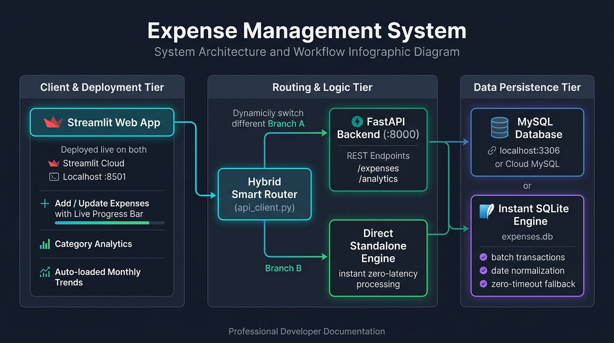

# Expense Management System

An expense management and analytics system built with Python, FastAPI, and Streamlit, featuring dual-engine database persistence (MySQL / SQLite fallback) and instant deployment on Streamlit Community Cloud.

**Live Application**: [https://expensemanagement-byradheshyam.streamlit.app/](https://expensemanagement-byradheshyam.streamlit.app/)



## System Architecture & Workflow

The system is organized into three interconnected tiers:

1. **Client & Deployment Tier (Streamlit Web App)**
   - **Live Cloud Deployment**: Accessible at `https://expensemanagement-byradheshyam.streamlit.app/`.
   - **Local Interface**: Runs locally on `http://localhost:8501`.
   - **Key Views**:
     - **Add / Update Expenses**: Form for daily expense entry with an interactive progress indicator and storage destination badge (SQLITE / API).
     - **Category Analytics**: Spending breakdown by category with dynamic date range filtering and percentage distribution.
     - **Monthly Trends**: Auto-loading monthly distribution chart for any selected year with dynamic year detection.

2. **Routing & Logic Tier (Hybrid Smart Router - `api_client.py`)**
   - **Branch A (API Mode)**: When the FastAPI backend server is online, requests are routed to REST endpoints (`/expenses`, `/analytics`, `/health`) running on `localhost:8000`.
   - **Branch B (Direct Standalone Engine)**: When running standalone (such as on Streamlit Community Cloud) or when the backend server is offline, the router communicates directly with the database layer with zero socket timeouts and instant response times.

3. **Data Persistence Tier (Dual Database Engine)**
   - **MySQL Database**: Supports local MySQL on `localhost:3306` or remote cloud MySQL configured via environment variables or Streamlit secrets (`[mysql]`).
   - **Instant SQLite Engine (`expenses.db`)**: Automatic, zero-configuration local SQLite fallback with batch atomic transactions, date normalization, and table schema auto-provisioning.

## Project Structure

- **assets/**: Contains system architecture and workflow infographic diagram (`workflow_diagram.jpg`).
- **fronted/**: Streamlit web application:
  - `app.py`: Main application entrypoint with clean layout and system status sidebar.
  - `add_update_ui.py`: Daily expense entry view with live save progress tracking.
  - `analytics_ui.py`: Category analytics breakdown and metrics.
  - `analtics_month.py`: Monthly expense distribution with dynamic year selector.
  - `api_client.py`: Hybrid smart router managing API requests and database fallback.
- **backend/**: FastAPI REST backend:
  - `server_check.py`: FastAPI server definitions and route handlers.
  - `db_helper.py`: Database access layer supporting both MySQL and SQLite.
  - `logging_setup.py`: Logger configuration.
  - `sample_expenses.json`: Sample test dataset.
- **test/**: Pytest test suite for database and backend operations.
- **requirements.txt**: Project dependencies.
- **README.md**: Project documentation and architecture guide.

## Setup & Running Instructions

### 1. Install Dependencies
```bash
pip install -r requirements.txt
```

### 2. Configure Database (Optional for MySQL)
- For MySQL: Ensure MySQL is running on `localhost:3306` with database `expense_manager`.
- For SQLite: No configuration needed. The system automatically initializes `expenses.db` if MySQL is unavailable.

### 3. Run FastAPI Backend (Optional)
From the project root:
```bash
python -m uvicorn backend.server_check:app --reload
```
Interactive API documentation is accessible at: `http://localhost:8000/docs`

### 4. Run Streamlit Frontend
From the project root:
```bash
streamlit run fronted/app.py
```
The web application will open at: `http://localhost:8501`

### 5. Streamlit Community Cloud Deployment
- **Repository**: `rschaurasiya/Expense_management`
- **Branch**: `main`
- **Main file path**: `fronted/app.py`
- **Live URL**: `https://expensemanagement-byradheshyam.streamlit.app/`

### 6. Run Test Suite
```bash
pytest -v
```